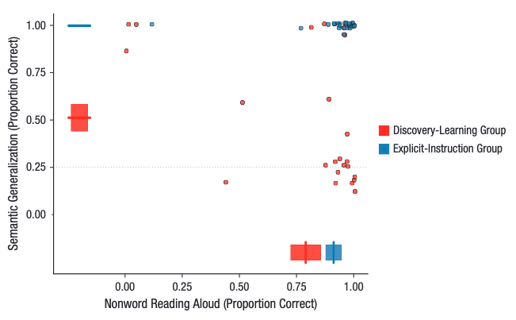

## Study: The Dramatic Impact of Explicit Instruction on Learning to Read in a New Writing System (2021)
#### [You can read the study here - https://pmc.ncbi.nlm.nih.gov/articles/PMC13021060/](https://pmc.ncbi.nlm.nih.gov/articles/PMC13021060/)

This study obtained an impressive result of 100% of explicitly trained adults meeting the 75% threshold learning a new language, whereas 25% of the discovery learners achieved threshold. The assessment checked if participants were able to transfer their learning to new word lists. However, I do note the following obfuscators:
- A member of the explicit group was excluded for near chance guessing in their final test. However the same behaviour was observed for several of the included discovery learners. It's convenient as this makes it possible to claim the sensational 100% figure (P473). 

## The Synthetic Language
The study created a synthetic, decodable language where 16 symbols had a one-to-one correspondance with phonemes. Additionally, in the systematic language, a categorical symbol was appended to the word to represent its type, such as animal or vehicle (P473). 

#### My Problem with Synthetic Languages
Synthetic languages are designed to be decodable. That's not English, which is mostly irregular and therefor requires some degree of discovery learning to figure out the majority of words. It's already known that clear languages with one-to-one grapheme-phoneme correspondances, like Spanish and Italian, learn to decode much quicker than English (6 months compared to 3 years in school curriculums). Phonics is evidently fantastic for learning the basic rules, but it's quite the lie to say all of English is so simple. I worry this impacts readers confidence when they've been told reading is a simple matter of decoding, when around 4/5ths of the language break at least one phonics rule. 

## Language Lessons 
The groups recieved the same training regime, with the exception of the first lesson (p476):
- typical training session: the disovery group did an extra spoken-language training session. In these sessions, the words were divided into 4 blocks of 6 words, with 3 repeats. Participants saw a picture, heard the word, then reproduced the word and translated it to English. 
- explicit instruction lesson: their first lesson had a powerpoint presentation mapping the visual language to sound and meaning. First, a visual symbol and sound were displayed. Participants reproduced this sound, then heard corrected feedback. In the systemic language, they also recieved feedback on symbol-to-picture and picture-to-symbol matching. They repeated these steps 4 times.

## Results
The difference between the explicit trained and discovery learners quickly closed during training, but the explicit learner did maintain a small but real performance gain. The groups performed similarly during the training phase, however few discovery learners performed well on both the decoding and the semantic character activities. It appears most discovery learners regarded the semantic character as irrelevent and stopped paying attention to it. The explicit instruction learners in the systematic language were told of its importance, and recalled the information during the test. This did not occur during the arbitrary language, where the character was forgotten. Both groups had good decoding and word-item idenitification, but most of the discovery group did not infer the meaning of the category character. 

## What About Irregular Words?
I'd have liked to see this language extended to model English more effectively. It'd be helpful for labs to explore which conditions result in learners who can quickly decode, but also break said decoding rules as needed to identify new words encountered in text. Sight words are helpful in warning kids that many words can't be sounded out, but what do they do when they encounter a word they haven't read in the wild? If it doesn't decode perfectly, do they assume its a sight word, or do they try flexing? I'd like to see labs figure out the conditions that encourages kids to try the later. 

#### Reference
Rastle, K., Lally, C., Davis, M. H., & Taylor, J. S. H. (2021). The Dramatic Impact of Explicit Instruction on Learning to Read in a New Writing System. Psychological Science, 32(4), 471–484. https://doi.org/10.1177/0956797620968790
