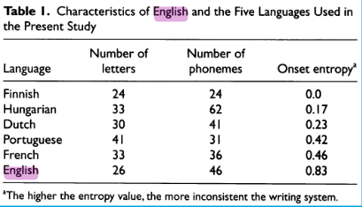

## TLDR 
I love reading about how English is an outlier among European languages. I am left wondering why phonological awareness is so important for orthographically deep languages like French (and probably English) but not Finnish or Chinese, at the extreme ends of the writing spectrum. 

#### Also I love this little table where they calculate the inconsistency of a writing system

## The Studies
#### [Mikko Aro, 2003 - https://www.researchgate.net](https://www.researchgate.net/publication/230734455_Learning_to_read_English_in_comparison_to_six_more_regular_orthographies)
All languages reached 85%> accuracy by the end of year 1, while English was at 50%. English students reach 85%> by grade 4. 

#### [Ziegler et al., 2010 - https://www.jstor.org](https://www.jstor.org/stable/41062248)
English has an onset entropy (unpredictability) score of 0.83, the next nearest European language neighbour is French, sitting at 0.46. Finnish has an onset entropy of 0.  

## My Thoughts
The later study aimed to produce a generalisable set of rules of the science of reading, that could then be applied to other languages like English. It found phonological awareness became less important as the languages orthography became clearer. So in France, phonological awareness had a lot more predictive power than in Finland. 

Extrapolating this outcome suggests English would benefit most from phonological awareness. The paper also cites evidence that Chinese reading studies have also found phonological awareness is predictive of reading skill, which sounds very positive for English. However, when I read Yang et al.’s (2025) study, they found that rapid automised naming was far more important for Chinese readers, which wasn't the case for most alphabet languages. Chinese, which has no grapheme-phoneme correspondence, is a little similar to English which is alphabetic but very inconsistent. It’s interesting to wonder for which languages phonological awareness may be more useful. When does it invert and become an unuseful predictor of peoples reading skills. 

#### References
Mikko Aro. (2003). Learning to read: English in comparison to six more regular orthographies. University of Jyva ̈skyla. Retrieved October 10, 2026, from https://www.researchgate.net/publication/230734455_Learning_to_read_English_in_comparison_to_six_more_regular_orthographies

Yang, X., Zhang, L., Liu, K., & Hong, Y. (2025). Reciprocal effects between phonological processing skills and Chinese word reading in kindergarten children: A longitudinal cross-lagged study. Early Childhood Research Quarterly, 73, 59–68. https://doi.org/10.1016/j.ecresq.2025.06.002

Ziegler, J. C., Bertrand, D., Tóth, D., Csépe, V., Reis, A., Faísca, L., Saine, N., Lyytinen, H., Vaessen, A., & Blomert, L. (2010). Orthographic Depth and Its Impact on Universal Predictors of Reading: A Cross-Language Investigation. Psychological Science, 21(4), 551–559.
